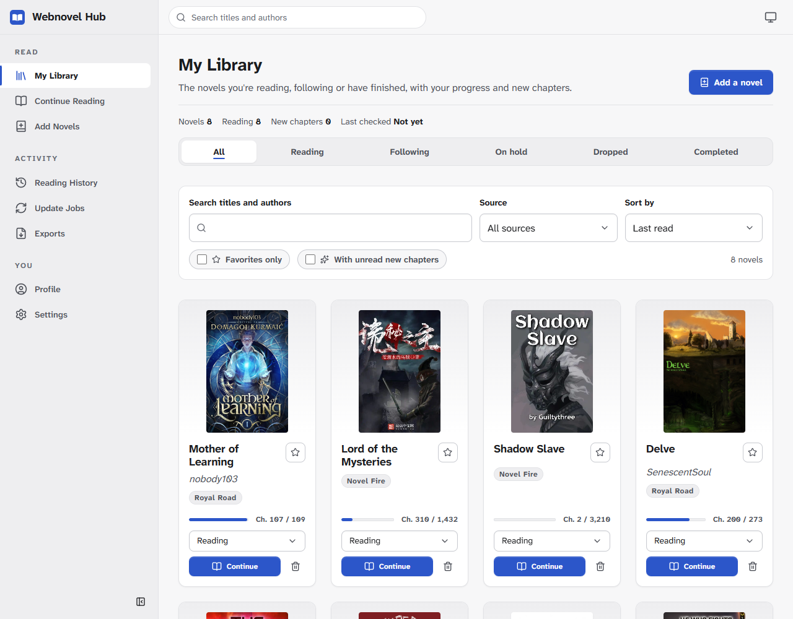
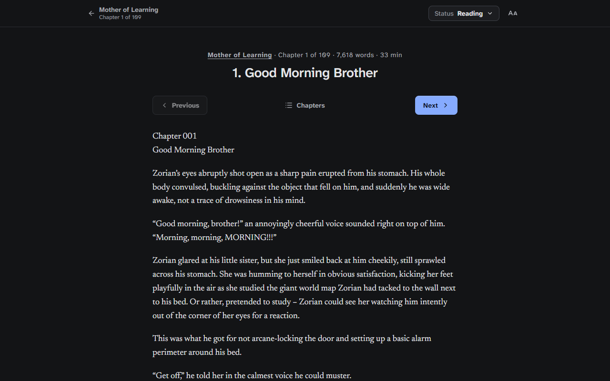
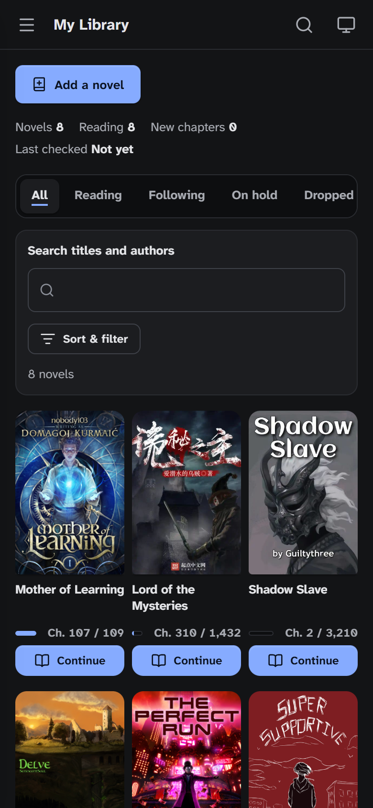
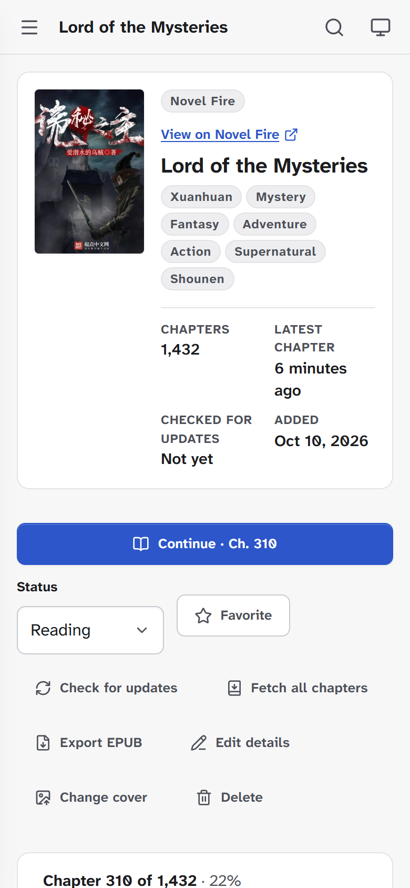
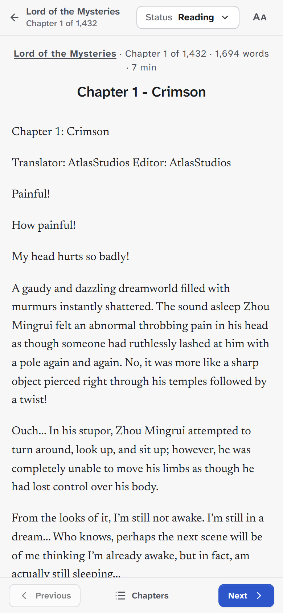

<div align="center">


# Webnovel Hub

A webnovel reader for Windows and Android. Add novels from supported sites or from EPUB
files, keep them in a local library, and read them offline.

[](https://github.com/Ismaeldlr/WebNovel_Hub/actions/workflows/ci.yml)
[](https://github.com/Ismaeldlr/WebNovel_Hub/releases/latest)
[](LICENSE)

</div>

## Download

Get the latest version from the [releases page](https://github.com/Ismaeldlr/WebNovel_Hub/releases/latest).

| Platform              | File                                            | Notes                                                                                    |
| --------------------- | ----------------------------------------------- | ---------------------------------------------------------------------------------------- |
| Windows 10 / 11 (x64) | `Webnovel.Hub_<version>_x64-setup.exe`          | Installs for your user only, no admin rights needed. Updates itself.                     |
| Android 7.0 or newer  | `webnovel-hub-v<version>-android-arm64-v8a.apk` | For most phones. If it won't install, use the `universal` APK, which runs on any device. |

The other APKs are for older 32-bit phones (`armeabi-v7a`) and emulators or x86 tablets
(`x86_64`). Each release also lists the SHA-256 checksum of every file.

**Windows:** the installer isn't code-signed yet, so SmartScreen may say "Windows protected
your PC". Choose **More info**, then **Run anyway**.

**Android:** the app isn't on the Play Store. Your phone will ask you to allow installing apps
from your browser or file manager the first time. On Android, the app tells you when a new
version is out and opens its download.

## Screenshots

<p align="center">
  
  
</p>
<p align="center">
  
  
  
</p>

## Features

- **Add novels by link.** Paste the address of a novel (or one of its chapters) from a
  [supported site](#supported-sites). The app saves its details, cover and chapter list.
- **Import EPUB files.** The details, cover and every chapter are stored at once.
- **Library.** Reading status, favourites, filters by status and site, sorting, and search by
  title or author.
- **Reader.** Light, sepia, dark and black (for OLED screens) themes, or match your device.
  Text size, line spacing, width and font. Previous and next chapter, and the chapter list, from the
  reader's bar.
- **Offline reading.** Chapters are saved as you read, and a few chapters ahead are downloaded
  automatically (you choose how many). **Fetch all chapters** downloads a whole novel.
- **New chapters.** The app checks the novels you're reading for new chapters every few
  hours, and can notify you. You can also check any novel by hand.
- **Export to EPUB.** Save a downloaded novel as an EPUB file for any e-book reader.
- **Backup and restore.** Save your whole library (novels, saved chapters, progress and
  settings) to one `.whub` file from Settings, and restore it on another computer or phone.
  The library a restore replaces is kept on the device, so you can put it back.
- **Reading history and stats.** Chapters read by day or by novel, reading streaks and 90 days
  of activity.
- **Your data stays on your device.** No account, no server, no tracking. The app only
  contacts the sites you add novels from, and GitHub to check for updates.

## Supported sites

| Site                                                  | Notes                                                                                                   |
| ----------------------------------------------------- | ------------------------------------------------------------------------------------------------------- |
| [Royal Road](https://www.royalroad.com)               |                                                                                                         |
| [WTR Lab](https://wtr-lab.com)                        | AI-translated chapters past the 10th need you to sign in to WTR Lab from the app's settings.            |
| [Ranobes](https://ranobes.net)                        | Pages are loaded in the app's own browser window, because the site checks visitors before showing them. |
| [Novel Fire](https://novelfire.net)                   |                                                                                                         |
| [Wuxiaworld](https://www.wuxiaworld.com)              | Free chapters only.                                                                                     |
| [ReadNovelFull](https://readnovelfull.com)            |                                                                                                         |
| [Novgo](https://novgo.net)                            |                                                                                                         |
| [NovelPing](https://novelping.com)                    |                                                                                                         |
| [WuxiaBox](https://www.wuxiabox.com)                  |                                                                                                         |
| [FanMTL](https://www.fanmtl.com)                      |                                                                                                         |
| [WuxiaSpot](https://www.wuxiaspot.com)                |                                                                                                         |
| [ReadNovel.eu](https://readnovel.eu)                  |                                                                                                         |
| [LNMTL](https://lnmtl.com)                            | Add novels by their novel page, not a chapter.                                                          |
| [WuxiaWorld.site](https://wuxiaworld.site)            |                                                                                                         |
| [LightNovelHeaven](https://lightnovelheaven.com)      |                                                                                                         |
| [Sleepy Translations](https://sleepytranslations.com) |                                                                                                         |
| [Hiraeth Translation](https://hiraethtranslation.com) |                                                                                                         |
| [TranslatinOtaku](https://translatinotaku.net)        |                                                                                                         |

Sites change their pages from time to time, which can break a source until the app is
updated. If a site stops working, or you'd like another one added,
[open an issue](https://github.com/Ismaeldlr/WebNovel_Hub/issues/new/choose).

The app only downloads what you ask for (a novel you add, the chapters you read or download,
update checks for novels you follow), with a delay between requests to the same site. It
doesn't solve CAPTCHAs or get around logins or paywalls.

## Where your data is

Everything is in one SQLite database on your device:

- **Windows:** `%APPDATA%\io.github.ismaeldlr.webnovelhub\library.db`. Uninstalling the app
  keeps it unless you tick the option to delete app data.
- **Android:** in the app's private storage. Uninstalling the app deletes it.

## Building from source

You need [Node.js](https://nodejs.org) 22.12 or newer (see [.nvmrc](.nvmrc)).

```bash
git clone https://github.com/Ismaeldlr/WebNovel_Hub.git
cd WebNovel_Hub
npm install
npm run dev
```

`npm run dev` opens the app in your browser at <http://localhost:5173>, backed by a local
development database in `data/dev.db`. This is the quickest way to work on the interface and
the scrapers.

To build the apps:

- **Windows:** also install [Rust](https://www.rust-lang.org/tools/install) and the
  [Tauri prerequisites](https://v2.tauri.app/start/prerequisites/). Then run
  `npm run dev:desktop` to run the app, or `npm run build:desktop` to build the installer.
- **Android:** also install [Android Studio](https://developer.android.com/studio). Then run
  `npm run sync --workspace @webnovel-hub/mobile` and open `apps/mobile/android` in Android
  Studio to run it on a phone or emulator.

See [CONTRIBUTING.md](CONTRIBUTING.md) for the commands, the tests and how to add a site.

## Project layout

```
apps/
  web/        The interface (React, TypeScript, Vite). Every app runs it.
  desktop/    Windows app (Tauri).
  mobile/     Android app (Capacitor).
packages/
  core/       Database, library logic, scrapers, update checks and EPUB import/export.
  shared/     Types shared by the interface and the core.
  platform-*/ What each app provides to the core: SQLite, HTTP, files and notifications.
```

## Disclaimer

Webnovel Hub isn't affiliated with any of the sites it reads from, and hosts no content. Novels
are downloaded by each user, to their own device, from sites they choose. Please support the
authors and translators you read.

## License

[PolyForm Noncommercial 1.0.0](LICENSE). You can use, change and share the app and its code for
any noncommercial purpose. Selling it, or using it commercially, isn't allowed.
